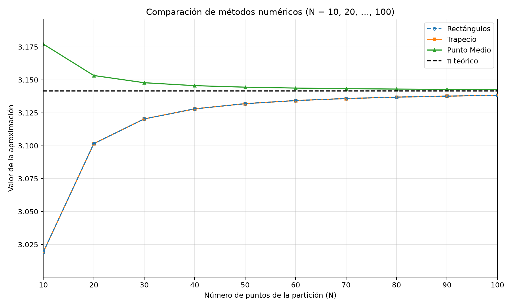
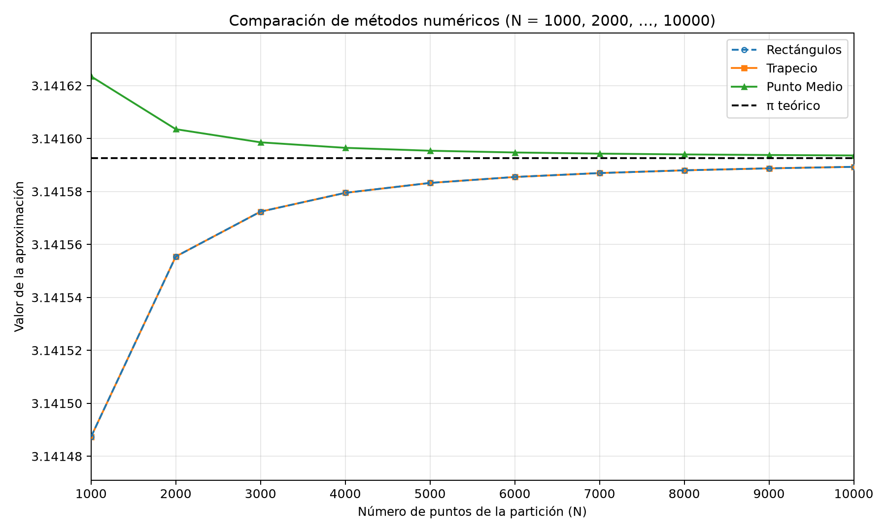

# Ejercicio 3: comparación de métodos de integración numérica

## Objetivo y función

Se comparan los métodos de rectángulos, trapecio y punto medio para aproximar

$$
I=\int_{-1}^{1} f(x)\,dx,
\qquad f(x)=2\sqrt{1-x^2}.
$$

Geométricamente, $f$ es el doble de la semicircunferencia superior del círculo unitario, así que el valor exacto es $I=\pi$. El código del ejercicio está en [ejercicio3.py](ejercicio3.py). Usa una partición equiespaciada y compara los tres métodos en los tamaños $N=10,20,\ldots,100$, $N=100,200,\ldots,1000$ y $N=1000,2000,\ldots,10000$, tal como pide la consigna.

La consigna especifica que $N$ es el número de **puntos** de la partición. Por tanto, estos puntos generan $N-1$ subintervalos de ancho

$$
h=\frac{1-(-1)}{N-1}=\frac{2}{N-1}.
$$

Los puntos son $x_i=-1+ih$, para $i=0,1,\ldots,N-1$.

## Los tres métodos

### Rectángulos: extremo izquierdo

La altura de cada rectángulo es el valor de la función en el extremo izquierdo del subintervalo:

$$
R_N=h\sum_{i=0}^{N-2}f(x_i).
$$

Es el método usual de rectángulos por la izquierda. La elección del extremo importa en general; en este problema las sumas por izquierda y por derecha coinciden porque ambos extremos del intervalo tienen altura cero.

### Trapecio

En cada subintervalo se aproxima la curva con la recta que une sus dos extremos:

$$
T_N=h\left(\frac{f(x_0)}{2}+\sum_{i=1}^{N-2}f(x_i)+\frac{f(x_{N-1})}{2}\right).
$$

### Punto medio

La altura del rectángulo de cada subintervalo se calcula en su centro:

$$
M_N=h\sum_{i=0}^{N-2}f\left(\frac{x_i+x_{i+1}}{2}\right).
$$

## Residuo

Para comparar cada aproximación $Q_N$ con el valor exacto, se define el residuo firmado como

$$
r_{Q,N}=Q_N-\pi.
$$

Si el residuo es negativo, el método subestima la integral; si es positivo, la sobreestima. Para decidir qué método es más preciso, comparamos $|r_{Q,N}|$, no solo el signo.

## Revisión matemática importante

### Rectángulos y trapecio coinciden en este problema

Aquí $f(-1)=f(1)=0$. La suma izquierda es

$$
R_N=h\sum_{i=0}^{N-2}f(x_i)=h\sum_{i=1}^{N-2}f(x_i),
$$

porque $f(x_0)=f(-1)=0$. En la fórmula del trapecio, los dos extremos también aportan cero, de modo que

$$
T_N=h\sum_{i=1}^{N-2}f(x_i)=R_N.
$$

Por ello, **en este ejercicio rectángulos por izquierda y trapecio dan el mismo resultado**, salvo diferencias insignificantes de redondeo. No sería correcto afirmar que rectángulos es peor que trapecio para esta configuración.

### Signo de los errores

En el interior del intervalo,

$$
f''(x)=-\frac{2}{(1-x^2)^{3/2}}<0,\qquad -1<x<1,
$$

así que la función es cóncava hacia abajo. Las cuerdas entre puntos de la curva quedan por debajo de ella, por lo que los trapecios subestiman la integral: $T_N<\pi$. Como $R_N=T_N$ en esta partición, los rectángulos izquierdos también subestiman.

La concavidad también implica que el valor en el punto medio de un subintervalo es al menos el promedio de los valores de la función en ese subintervalo. Por eso, el rectángulo de punto medio sobreestima la integral: $M_N>\pi$ en los casos calculados.

### ¿Cuál es más preciso?

En todos los tamaños ensayados, el residuo absoluto del punto medio es menor que el de rectángulos/trapecio. Por tanto, **el punto medio es el método más preciso entre estos tres para los $N$ evaluados**. La explicación correcta es que su error es de signo contrario al del trapecio y de menor magnitud en estos datos; no debe justificarse con una afirmación imprecisa sobre una tangente que cancela áreas ni comparándolo directamente con Simpson.

Además, aunque la función es continua en $[-1,1]$, su derivada se vuelve no acotada al acercarse a los extremos. Por eso, no conviene aplicar sin más las estimaciones habituales de error que requieren derivadas segundas acotadas en todo el intervalo. La tabla permite comparar empíricamente la convergencia en los rangos solicitados.

## Resultados representativos

La ejecución del programa produce las tablas completas en archivos CSV. Estos valores resumen la tendencia:

| $N$ | Rectángulos | Residuo rect. | Trapecio | Residuo trap. | Punto medio | Residuo punto medio |
|---:|---:|---:|---:|---:|---:|---:|
| 10 | 3.019231832818 | $-1.2236\times10^{-1}$ | 3.019231832818 | $-1.2236\times10^{-1}$ | 3.177138932722 | $+3.5546\times10^{-2}$ |
| 100 | 3.138218039202 | $-3.3746\times10^{-3}$ | 3.138218039202 | $-3.3746\times10^{-3}$ | 3.142580317027 | $+9.8766\times10^{-4}$ |
| 1000 | 3.141487319046 | $-1.0533\times10^{-4}$ | 3.141487319046 | $-1.0533\times10^{-4}$ | 3.141623503078 | $+3.0849\times10^{-5}$ |
| 10000 | 3.141589326932 | $-3.3267\times10^{-6}$ | 3.141589326932 | $-3.3267\times10^{-6}$ | 3.141593627938 | $+9.7435\times10^{-7}$ |

Se observa que los tres métodos se acercan a $\pi$ al aumentar $N$. Rectángulos y trapecio coinciden; punto medio se acerca desde arriba y tiene menor error absoluto en estos ejemplos.

## Tablas y gráficas generadas

Al ejecutar el programa, la carpeta `resultados_ejercicio3/` contiene:

- `tabla_metodos_10_a_100.csv`;
- `tabla_metodos_100_a_1000.csv`;
- `tabla_metodos_1000_a_10000.csv`;
- `grafica_metodos_10_a_100.png`;
- `grafica_metodos_100_a_1000.png`;
- `grafica_metodos_1000_a_10000.png`.

Cada tabla contiene $N$, las tres aproximaciones y sus tres residuos firmados. Cada gráfica muestra las curvas de rectángulos, trapecio y punto medio, además de una línea horizontal en $\pi$. Se hacen gráficas separadas por rango, para evitar comprimir todos los puntos en una única figura y facilitar la lectura, como recomienda la nota de la consigna.

### Gráficas

**Rango $N=10,20,\ldots,100$**



**Rango $N=100,200,\ldots,1000$**


**Rango $N=1000,2000,\ldots,10000$**



Los CSV también se pueden abrir directamente: [tabla N 10–100](resultados_ejercicio3/tabla_metodos_10_a_100.csv), [tabla N 100–1000](resultados_ejercicio3/tabla_metodos_100_a_1000.csv) y [tabla N 1000–10000](resultados_ejercicio3/tabla_metodos_1000_a_10000.csv).

## ¿Es integrable de Riemann?

Sí. $1-x^2\geq0$ en $[-1,1]$, y la función $2\sqrt{1-x^2}$ es continua en todo ese intervalo cerrado y acotado. Toda función continua sobre un intervalo cerrado es integrable de Riemann. Los datos concuerdan con esto: las aproximaciones numéricas convergen a $\pi$ cuando se refina la partición.

## Cómo ejecutar

Con el entorno virtual activado, desde la carpeta del proyecto:

```bash
python ejercicio3.py
```

El programa imprime las tablas en la terminal y guarda los CSV y PNG en `resultados_ejercicio3/`. Matplotlib se declara en [requirements.txt](requirements.txt); si hace falta, se instala con `python -m pip install -r requirements.txt`.
